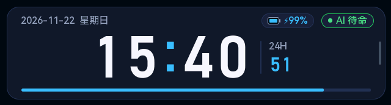
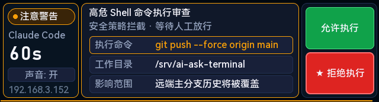
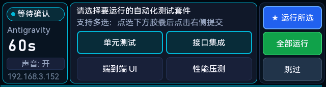
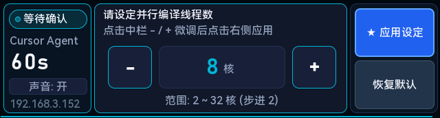
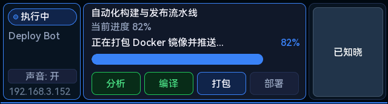

# ESP32-S3 AI Ask-Me Desktop Terminal

基于 **微雪 Waveshare `ESP32-S3-Touch-LCD-3.49` (V2 / Rev1.1)** 打造的桌面 AI 交互提示终端与极简 RTC 桌面时钟。

支持通过局域网 HTTP API / MCP Server 接入 **Claude Code / Cursor / Antigravity / OpenClaw / 自定义 Agent**，将高危操作审批、多选决策、数值微调、任务状态与音效提醒无缝托管到桌面硬件触控屏上。

## 实机界面预览

| 场景 | 实机截屏（`640×172`） |
| --- | --- |
| **桌面时钟待机**（含 18650 电量 / USB 图标 & AI 状态） |  |
| **高危命令审查**（`warning` + `kv` 键值高亮） |  |
| **多选决策胶囊**（`asking` + `choice` 多选提交） |  |
| **数值微调步进**（`asking` + `number` 长按连发） |  |
| **多阶段任务进度**（`running` + `progress` 流水线） |  |

---

## 核心特性

### 1. 桌面 AI 交互终端（HTTP API + MCP）
- **多形态交互卡片**：支持 `text`（摘要）、`kv`（键值详情）、`progress`（进度条）、`choice`（单选/多选）、`number`（数值加减微调）五种 DSL 布局。
- **物理/触控双通道审批**：支持在 3.49 寸横屏（`640×172`）触控点击，或直接按机身 `BOOT` 物理按键一键确认。
- **和弦合成音效提示**：内置 ES8311 + I2S 24kHz 实时音频合成器，支持不同状态提示音（询问 / 危险警告 / 成功 / 失败 / 按键反馈）及自定义旋律播放。
- **开箱即用的主机端工具（`host_tool/`）**：内置 MCP Server（`ai_terminal_mcp.py`）、权限审批 Hook（`permission_hook.py`）、CLI 调试工具（`ask_cli.py`）与各主流 AI Agent 接入指南（[AGENT_SETUP_PROMPTS.md](AGENT_SETUP_PROMPTS.md)）。

### 2. 极简桌面时钟与系统设置
- **高刷流畅显示**：LVGL v8 `direct_mode` 局部脏矩形渲染 + IRAM 零拷贝分块旋转直推 QSPI DMA（`66 FPS` 刷新，`66 Hz` 触摸轮询）。
- **右侧滑出抽屉 & 全功能设置页**：支持亮度调节（20kHz PWM 避开电容触摸频段）、待机休眠时长、立即息屏休眠（In-Cell TDDI 息屏触控唤醒）、自动横屏/180° 翻转、音量/静音、PCF85063 硬件 RTC 闹钟、NTP 自动校时与 Captive Portal 扫码配网。
- **18650 电池精准电量与分级功耗**：
  - 12 点单节 18650 锂电非线性放电曲线 + 8 次去极值均值采样 + 2% 迟滞防抖 + USB 插电精准识别。
  - 三级动态调频（亮屏稳态 `240MHz` 零卡顿、预暗屏/休眠自动降频 `80MHz` + IMU 抬手唤醒 + Wi-Fi 深度省电）。

### 3. 全量中文字库（29,089 字形零拷贝映射）
- 独立 `4MB` `font_dat` Flash 分区（`0x410000`）+ `esp_partition_mmap` 零拷贝读取，不占用内部 RAM。
- 收录 **29,089 个 4bpp 高清字形**：涵盖 CJK 基本区（20,902 字）+ CJK 扩展 A 区（6,582 字）+ 完整中英文标点/全角/数理符号/希腊字母/拼音声调/日语假名/制表符及常用 UI 状态符号（`⚡ ✓ ✕ ⚠` 等）。

---

## 硬件要求

- **开发板**：Waveshare `ESP32-S3-Touch-LCD-3.49` **V2 (`Rev1.1`)**
  - MCU：ESP32-S3R8（16MB Flash + 8MB Octal PSRAM）
  - 屏幕与触控：AXS15231B（172×640 IPS QSPI + 独立 I2C1 电容触控）
  - 外设：TCA9554PWR（IO 扩展）、ES8311 + ES7210（音频）、QMI8658C（六轴 IMU）、PCF85063A（RTC）
  - 供电：USB-C 或单节 18650 锂电池

> **注意**：本项目引脚配置严格对应 **V2 (`Rev1.1`)** 硬件版本（`LCD_BL_EN` / `LCD_RST` 在 TCA9554 上的引脚与 V1 互换）。

---

## 快速编译与烧录

### 环境要求
- **ESP-IDF v5.x / v6.1+**（已验证通过 ESP-IDF `v6.1.1`）
- Python 3 + Pillow（仅在需要重新生成字库时使用）

### 1. 编译固件
```bash
idf.py set-target esp32s3
idf.py build
```

### 2. 烧录固件与独立字库分区
```bash
# 烧录程序固件（将 COM5 替换为实际串口）
idf.py -p COM5 flash

# 烧录全量 29,089 字形中文字库至 font_dat 分区 (0x410000)
python -m esptool --chip esp32s3 -p COM5 -b 460800 write-flash 0x410000 fonts_bin/font_cn_16.bin
```

> 如需自定义字库，可修改 `tools/gen_fonts.py` 后运行 `python tools/gen_fonts.py` 重新生成 `fonts_bin/font_cn_16.bin`。

---

## HTTP API 速查

设备联网后（首次使用可长按 `BOOT` 或通过右侧抽屉「配网」扫码连接热点配网），监听 `80` 端口：

| 接口 | 方法 | 说明 |
| --- | --- | --- |
| `/api/state` | `GET` | 查询设备在线状态、IP、Wi-Fi 信号、电量、音量与当前活跃请求 |
| `/api/ask` | `POST` | 向屏幕推送交互弹窗卡片（支持异步或阻塞等待用户操作） |
| `/api/status` | `POST` | 推送通知型状态卡片（如任务完成/报错提示） |
| `/api/dismiss` | `POST` | 关闭当前屏幕弹窗返回时钟主页 |
| `/api/sound` | `POST` | 播放内置预设音效或自定义音符旋律 |
| `/screenshot.bmp` | `GET` | 实时截取当前屏幕画面（BMP 格式） |

更多 AI Agent / MCP Server 接入方式，请查看 [AGENT_SETUP_PROMPTS.md](AGENT_SETUP_PROMPTS.md) 与 [host_tool/README.md](host_tool/README.md)。

---

## 开源协议

本项目基于 [MIT License](LICENSE) 开源。
